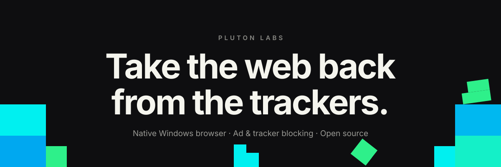

 

**Pluton Labs** builds fast, native, privacy-first tools for Windows.
Block ads and trackers everywhere, and browse with a lightweight browser that stays out of your way.

 

<a href="https://github.com/plutonlabs/shield"><b>⬇ Get Pluton Shield</b></a>
&nbsp;·&nbsp;
<a href="https://github.com/plutonlabs/neat"><b>NEAT Browser</b></a>
&nbsp;·&nbsp;
<a href="https://github.com/plutonlabs?tab=repositories"><b>All repositories</b></a>

 

## Products

| | Project | What it does |
|---|---|---|
| 🛡️ | [**Shield**](https://github.com/plutonlabs/shield) | Free ad blocker for Windows 10/11. Blocks ads and trackers in every browser, with an optional adult-content filter and SafeSearch. |
| 🌐 | [**NEAT Browser**](https://github.com/plutonlabs/neat) | A lightweight, native Windows browser built with WinUI 3 + WebView2. Vertical/horizontal tabs, focus mode, and a built-in adblock-rust content blocker. |

## Open source

| Project | Description |
|---|---|
| [**neat-filters**](https://github.com/plutonlabs/neat-filters) | Filter lists and scripting resources for NEAT's adblock engine, auto-built from uBlock Origin upstream every 6 hours. |
| [**neat-adblock**](https://github.com/plutonlabs/neat-adblock) | C ABI wrapper (`neat_adblock.dll`) around adblock-rust. Loads filter lists from neat-filters and exposes network and cosmetic blocking APIs. |
| [**neat-android**](https://github.com/plutonlabs/neat-android) | NEAT for Android, written in Kotlin. |

## Built with

`C#` · `WinUI 3` · `WebView2` · `Rust` · `Kotlin` · `JavaScript`

 

📍 Viet Nam &nbsp;·&nbsp; Stars and issues are always welcome.

